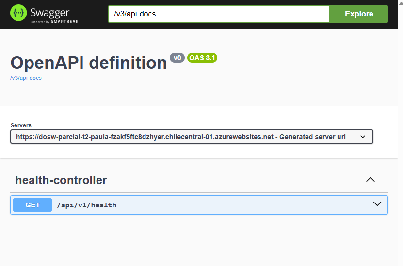
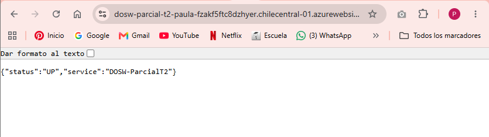
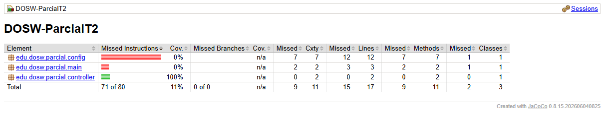
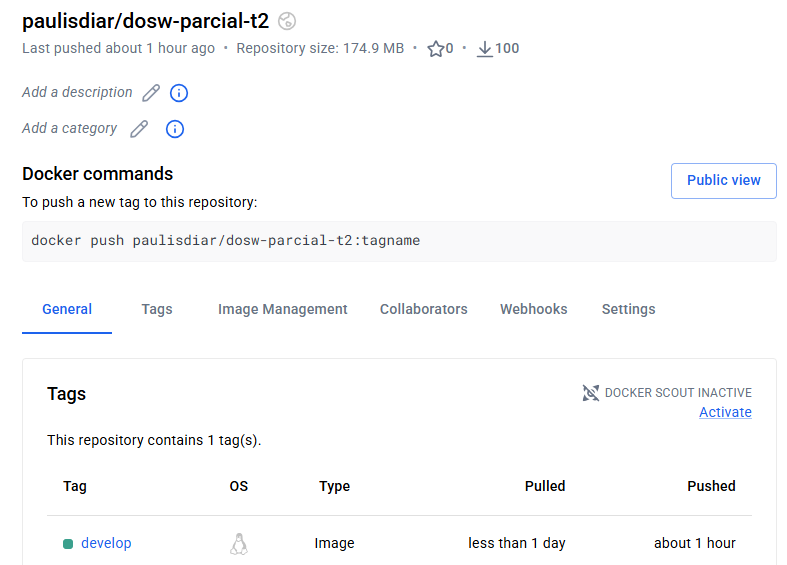
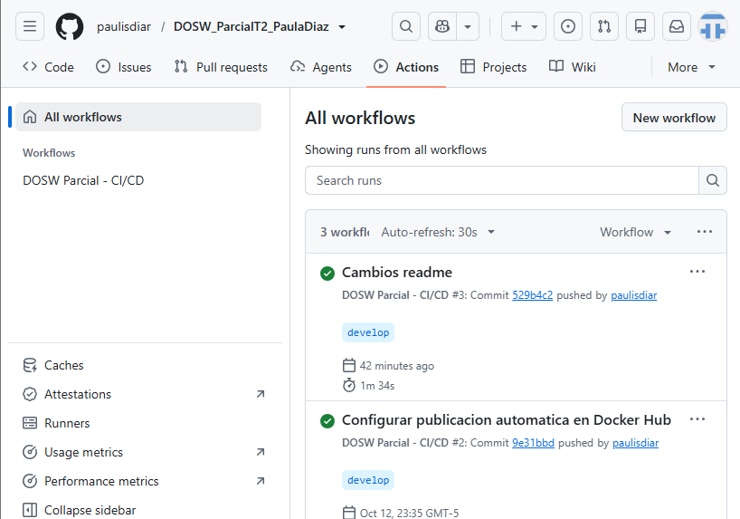
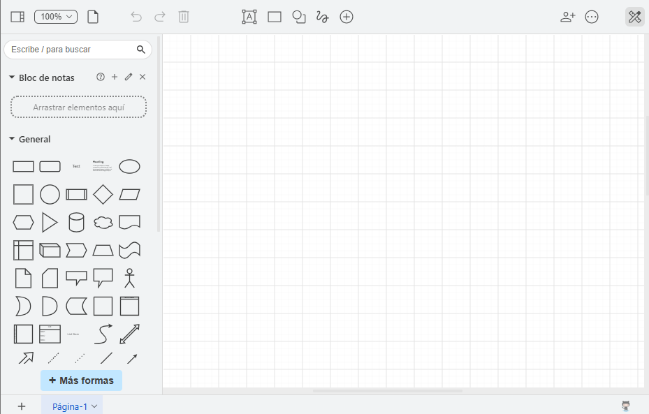
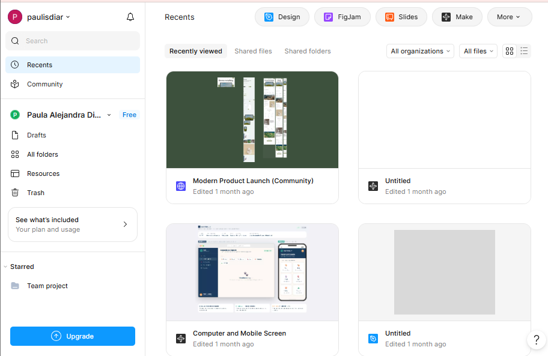

# DOSW_ParcialT2_PaulaDiaz

## Índice
1. [Datos del estudiante](#1-datos-del-estudiante)
2. [Descripción del proyecto](#2-descripción-del-proyecto)
3. [Despliegue](#3-despliegue)
4. [Estructura del proyecto](#4-estructura-del-proyecto)
5. [Tecnologías y dependencias](#5-tecnologías-y-dependencias)
6. [Configuración y variables de entorno](#6-configuración-y-variables-de-entorno)
7. [Cómo ejecutar](#7-cómo-ejecutar)
8. [Pruebas](#8-pruebas)
9. [Docker](#9-docker)
10. [CI/CD](#10-cicd)
11. [Herramientas de modelado y diseño](#11-herramientas-de-modelado-y-diseño)

## 1. Datos del estudiante

- **Nombre completo:** Paula Alejandra Díaz Arredondo
- **Profesor agregado como colaborador:** Martin

## 2. Descripción del proyecto

Servicio base desarrollado en Java con Spring Boot para el parcial práctico de DOSW. Cuenta con una estructura organizada bajo el patrón MVC, un endpoint de salud y configuración para persistencia con MongoDB. Incluye pruebas automatizadas, documentación OpenAPI y preparación para despliegue mediante contenedores y CI/CD.

## 3. Despliegue

- **Aplicación en Azure:** https://dosw-parcial-t2-paula-fzakf5ftc8dzhyer.chilecentral-01.azurewebsites.net
- **Health:** https://dosw-parcial-t2-paula-fzakf5ftc8dzhyer.chilecentral-01.azurewebsites.net/api/v1/health
- **Swagger UI:** https://dosw-parcial-t2-paula-fzakf5ftc8dzhyer.chilecentral-01.azurewebsites.net/swagger-ui/index.html
- **OpenAPI JSON:** https://dosw-parcial-t2-paula-fzakf5ftc8dzhyer.chilecentral-01.azurewebsites.net/v3/api-docs



## 4. Estructura del proyecto

- `controller`: controladores REST, DTOs, mappers y manejadores de errores.
- `core`: lógica de negocio, modelos, validadores y utilidades.
- `persistence`: documentos MongoDB, repositorios y mappers de persistencia.
- `config`: configuración de la aplicación y seguridad.
- `main`: clase principal de Spring Boot.
- `src/test`: pruebas automatizadas.
- `docs/uml`: diagramas UML.
- `docs/images`: imagenes del proyecto.

## 5. Tecnologías y dependencias

| Tecnología | Uso |
|---|---|
| Java 26 | Lenguaje de programación |
| Maven 3.9.16 | Gestión de dependencias y construcción |
| Spring Boot | Framework de la aplicación |
| Spring Web | API REST |
| Spring Data MongoDB | Persistencia documental |
| Spring Security y JWT | Componentes de seguridad y tokens |
| Springdoc OpenAPI / Swagger | Documentación de la API |
| Lombok y MapStruct | Reducción de código repetitivo y mapeo |
| JUnit y Mockito | Pruebas automatizadas |
| JaCoCo | Reporte de cobertura de pruebas |
| Docker | Empaquetado y ejecución del servicio |
| GitHub Actions | Integración continua |

> Verificar las versiones exactas de las dependencias en `pom.xml`.

## 6. Configuración y variables de entorno

| Variable | Descripción |
|---|---|
| `MONGODB_URI` | URI de conexión a MongoDB |
| `JWT_SECRET` | Secreto utilizado para firmar tokens JWT |
| `PORT` | Puerto de ejecución de la aplicación |
| `WEBSITES_PORT` | Puerto que Azure utiliza para enrutar al contenedor |

## 7. Cómo ejecutar

### Local con Maven

Requiere Java y Maven instalados, además de una instancia accesible de MongoDB y las variables de entorno necesarias.

```bash
mvn clean verify
mvn spring-boot:run
```

Endpoint de salud local: `http://localhost:8080/api/v1/health`

### Local con Docker

Construir la imagen:

```bash
docker build -t dosw-parcial:local .
```

Ejecutar el contenedor, proporcionando `JWT_SECRET` y `MONGODB_URI` mediante variables de entorno:

```bash
docker run --rm -p 8080:8080 \
  -e JWT_SECRET=<secreto_local> \
  -e MONGODB_URI=<uri_mongodb> \
  dosw-parcial:local
```

## 8. Pruebas

Ejecutar las pruebas y generar el reporte de cobertura:

```bash
mvn clean verify
```

- **Reporte JaCoCo:** `target/site/jacoco/index.html`
- **Evidencia:** 
## 9. Docker

El proyecto incluye `Dockerfile` multietapa y `.dockerignore`.

- **Imagen publicada:** `paulisdiar/dosw-parcial-t2`
- **Etiqueta desplegada en Azure:** `develop`
- **Construcción local:** `docker build -t dosw-parcial:local .`
- **Evidencia:**  

## 10. CI/CD

El pipeline está configurado en `.github/workflows/ci-cd.yml` y se ejecuta mediante GitHub Actions.

- **Rama de trabajo:** `develop`
- **Verificación:** compilación y pruebas automatizadas.
- **Publicación:** imagen Docker en Docker Hub.
- **Despliegue:** Azure App Service.
- **Evidencia:** 


## 11. Herramientas de modelado y diseño

- **Herramienta de diagramación:** [Lucidchart, Draw.io o Miro]
- **Diseño de interfaces:** Figma


- 